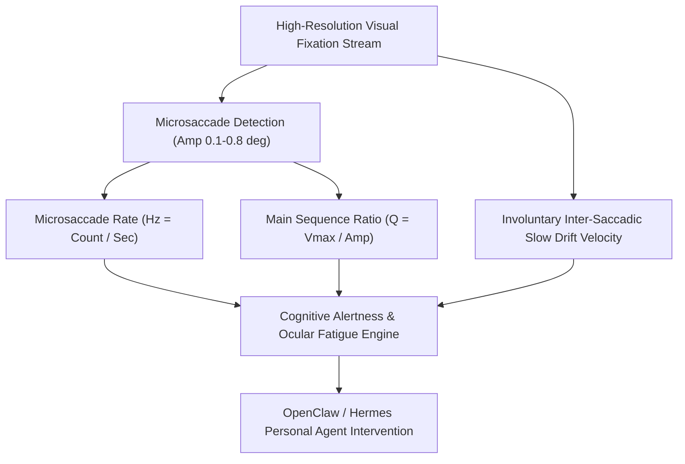

# Ocular Microsaccade Rate & Fixational Fatigue Skill

[](LICENSE)
[](https://www.python.org/)
[](requirements.txt)
[](mcp_server.py)
[](SKILL.md)

Zero-dependency sovereign personal agent skill for evaluating ocular fixational microsaccade rate (Hz), main sequence velocity kinetics, involuntary ocular drift, and mental vigilance fatigue.



## Features
- **Deterministic Math**: Pure Python standard library implementation with zero external dependencies.
- **Ocular Kinematics Standards**: Implements validated equations for fixational microsaccade frequency, main sequence velocity scaling, and ocular drift velocity.
- **Mental Fatigue & Drowsiness Screening**: Sensitive detection of central vigilance drops and microsleep risks during prolonged cognitive effort.
- **Model Context Protocol (MCP)**: Native JSON-RPC tool integration for LLMs and autonomous agents.

## Quickstart

```python
from client import OcularMicrosaccadeRateClient

client = OcularMicrosaccadeRateClient()
result = client.evaluate_microsaccade_dynamics(
    fixation_duration_sec=30.0,
    microsaccade_count=54,
    mean_amplitude_deg=0.35,
    mean_peak_velocity_deg_s=15.2,
    mean_drift_velocity_deg_s=0.32
)
print("Microsaccade Rate:", result["microsaccade_rate_hz"], "Hz")
print("Alertness Score:", result["fixational_alertness_score"])
print("Classification:", result["classification"])
```

## License
Apache-2.0
